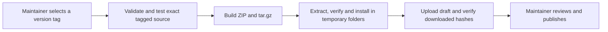

# Gitea hosting and releases

The project uses [GitHub workflows](RELEASING.md) for hosted CI and draft releases.
The tools in `ci/gitea/` and `tools/publish-gitea.mjs` support an optional self-hosted setup.
No Gitea workflow is included; a maintainer must configure its triggers, checkout, checks
and publication steps before running jobs. The GitHub workflows run only on GitHub.com.

## Packaging and publication

Follow the [source preparation and tagging steps](RELEASING.md#prepare-and-publish), using the Gitea
repository as `origin` and waiting for your configured source checks instead of GitHub's hosted jobs.
Rebuild and check the generated plugin payload before committing the release source. Source tagging
requires no local activation or installation receipt. Use the [portable packaging commands](#local-packaging)
for the selected tag. Packages contain the
version summary, exact source commit, installation prerequisites, file inventory and checksums.
They contain no local installation receipts, credentials or runtime state.

A custom release job must validate and check out the intended tag, confirm it belongs to
`origin/main`, run `npm run format:check` and `npm run ci`, build and smoke-install both archives, then run
`node tools/publish-gitea.mjs release-artifacts`. The publisher creates a draft; a maintainer
reviews and publishes it explicitly. Publishing does not activate a local installation.

Map these values into the publisher step's process environment in your custom workflow:

The Gitea examples are templates: replace `OWNER` with your Gitea account or organization,
the `example.invalid` URLs with your server addresses, and `YOUR_*` values with your Docker names.
These values describe your optional Gitea setup, independently of this project's GitHub owner, `PolaronQuasi`.

| Environment name    | Value to supply                                                                                                                               |
| ------------------- | --------------------------------------------------------------------------------------------------------------------------------------------- |
| `GITEA_SERVER_URL`  | The container-accessible URL stored in the repository Actions variable `CODEX_SUBAGENTS_FOR_CLAUDE_CODE_FORGE_URL`.                           |
| `GITEA_REPOSITORY`  | `OWNER/codex-subagents-for-claude-code` for the repository being released.                                                                    |
| `GITEA_TOKEN`       | The job's short-lived repository token, explicitly passed to the publisher.                                                                   |
| `GITEA_ASSET_TOKEN` | The repository Actions secret `CODEX_SUBAGENTS_FOR_CLAUDE_CODE_ASSET_TOKEN` provisioned below for private Gitea 1.24 attachment verification. |

The stored Actions variable and secret names are not the environment names the publisher reads;
your workflow must wire them explicitly. If `GITEA_ASSET_TOKEN` is omitted, downloads use
`GITEA_TOKEN`, which is suitable for public repositories but insufficient for the private attachment
route described below. The repository includes no Gitea workflow that supplies this mapping.



Do not move released tags or replace published downloads. Protect version tags and restrict write
access. An interrupted upload can resume only a matching draft for the exact commit: the publisher
checks present assets and uploads missing ones. A conflicting or corrupt asset stops publication
for manual review; it is never deleted or replaced. Run the same tagged tools for a retry.

## Docker Compose runner

The repository-scoped runner uses `ci/gitea/compose.yml`. Jobs run as the unprivileged `node`
user **inside that container**, with label `codex-subagents-for-claude-code-linux`. Docker's socket and host profile
folders are not mounted. The image pins Node's base digest and Gitea runner 5.2.3's download checksum;
it currently targets Linux amd64. Docker Desktop must be running for jobs to execute.

From the repository root, use PowerShell with an existing Git Credential Manager login to Gitea:

```powershell
.\ci\gitea\setup-runner.ps1 `
  -Server https://forge.example.invalid `
  -Repository OWNER/codex-subagents-for-claude-code `
  -ContainerServer https://forge-container.example.invalid `
  -DockerNetwork YOUR_EXISTING_GITEA_NETWORK
```

`Server` is reachable from the host; `ContainerServer` is reachable from the container on the named
external Docker network. The bootstrap creates the non-secret repository Actions variable
`CODEX_SUBAGENTS_FOR_CLAUDE_CODE_FORGE_URL` for checkout and upload, and saves only connection settings in the ignored
`ci/gitea/.env`. This avoids treating `localhost` inside Docker as the Windows host. It does
not change Gitea's shared server configuration.

For a **private repository on Gitea 1.24**, an instance administrator also provisions a restricted
download verifier once:

```powershell
.\ci\gitea\setup-asset-reader.ps1 `
  -Server https://forge.example.invalid -Repository OWNER/codex-subagents-for-claude-code
```

This creates `codex-subagents-for-claude-code-assets`, gives it read-only access to this repository, disables repository
and organization creation, and stores a `read:repository` token in the encrypted repository Actions
secret `CODEX_SUBAGENTS_FOR_CLAUDE_CODE_ASSET_TOKEN`. The random account password is not retained. Existing secrets are
preserved; an existing account is not reset unless the administrator explicitly uses
`-RepairIncomplete` to resume an inspected, interrupted provisioning attempt. Use a distinct account
name when provisioning another repository. Rotate the token through the service account and replace
that secret before revoking the old token. A server administrator can reset the account password
for that operation.

Repair resets the existing account's password and limits, then deletes its
`codex-subagents-for-claude-code-asset-download` token, if it has one, before creating a new one. An attempt that
stopped after creating the token but before storing the secret leaves a token whose value was never
shown, and Gitea refuses a second token with the same name. The reader, who owns the token, deletes
it, signing in with the password repair has just set: the least privilege that can. When there is
no such token, repair goes on. Repair refuses an account whose profile names another repository,
because that repository still uses its token; provision each repository under its own account name.

The registration token is passed only to a temporary registration container. Its runner identity
persists in the `registration` volume; cached actions/npm files and Node toolchains have separate
volumes. The daemon has no registration token in its environment. Re-running setup preserves the
registration. Do not reuse its volumes for another repository or instance.

```powershell
docker compose -f ci/gitea/compose.yml ps
docker compose -f ci/gitea/compose.yml logs --tail 100
docker compose -f ci/gitea/compose.yml stop
docker compose -f ci/gitea/compose.yml up -d --wait
```

The runner restarts with Docker. `stop` allows up to 31 minutes for an active job to finish. Ordinary
`down` preserves volumes; `down -v` removes the runner identity and caches and requires registration
again. Do not remove those volumes during an active job. Docker health reports Gitea connectivity;
also check the runner's online state in repository **Settings → Actions → Runners**.

Capacity is one job, with a 30-minute runner-enforced timeout, two CPUs and 4 GiB memory. Logs are
retained for seven days. One runner serializes jobs, including release uploads; keep this dedicated
registration at capacity one. Gitea 1.24 ignores workflow `concurrency`, `permissions` and job
`timeout-minutes`, so these settings are enforced by the runner and container instead. See the
[Gitea compatibility reference](https://docs.gitea.com/1.24/usage/actions/comparison/).

This is a persistent trusted-code runner: jobs can access its writable workspace and registration
volume. Configure workflow triggers to exclude fork pull requests. Do not execute unreviewed external code on it.

Host-mode jobs also share the runner container's place on the Docker network named by
`-DockerNetwork`, so job code can connect to every other service on that network, such as Gitea's
database or cache, and not only to Gitea's web port. Prefer a dedicated network that holds only
Gitea's web container. Attach that container to it as an additional network, under the host name
used in `-ContainerServer`, and pass the new network to the setup script; Gitea keeps its other
networks for its database:

```powershell
docker network create codex-subagents-for-claude-code-ci
```

Declare that network, with the alias, in Gitea's own Compose file or run command, so it survives a
recreated container, for example after an upgrade. An attachment made with
`docker network connect --alias gitea codex-subagents-for-claude-code-ci YOUR_GITEA_WEB_CONTAINER` lasts only until the
container is recreated, after which the runner can no longer reach Gitea:

```yaml
services:
  gitea:
    networks:
      default:
      codex-subagents-for-claude-code-ci:
        aliases: [gitea]
networks:
  codex-subagents-for-claude-code-ci:
    external: true
```

For a runner already set up, set `GITEA_DOCKER_NETWORK` in `ci/gitea/.env` to the new
network by hand (setup refuses to change an existing `.env`), then run `up -d --wait` again.

The release adapter uses the job's short-lived `GITEA_TOKEN` for publication. Gitea 1.24's private
attachment route checks ordinary user access rather than the job's repository grant, so download
verification uses the separate read-only secret above. It cannot publish or change repository files.
Public repositories can omit this secret. No account credential is committed to the source.
The adapter downloads each validated attachment UUID directly from the configured Gitea server.
It ignores the advertised browser download URL and refuses redirects or requests to other origins.

For image/config updates, change the pinned version/checksum together, review the diff, wait for an
idle runner, then rerun setup. Changing `config.yaml` or `entrypoint.sh` requires rebuilding the image.
Windows source checks remain available locally through `npm run ci`; this Compose runner executes
Linux jobs using the Node versions selected by your workflow.

## Local packaging

The build and smoke commands do not depend on Gitea. From a clean checkout at the intended tag,
with `origin/main` fetched:

```bash
node tools/distribution.mjs build vMAJOR.MINOR.PATCH release-artifacts
node tools/distribution.mjs smoke release-artifacts
```

The output directory must be empty. The tools need Node 22+, Git and tar; Linux additionally needs
unzip, and Windows uses PowerShell's .NET ZIP reader. `npm run ci` renders disposable agent/skill
definitions before running source checks and tests. It does not modify the live installation.

Keep each repository's runner registration and asset reader separate. For GitHub hosting,
use the [GitHub setup guide](GITHUB-SETUP.md); the GitHub publisher uses its job token.

For activating or rolling back a local installation after publication, use
[the managed installation procedure](DEVELOPMENT.md#activating-a-local-release).
