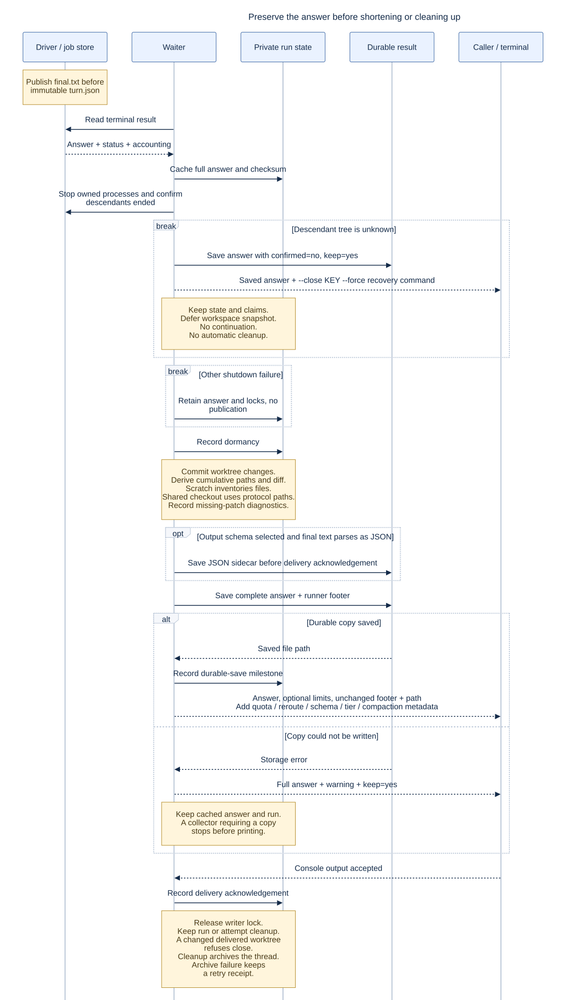

# How Codex subagents for Claude Code works

Start with the architecture, then follow one run through waiting, delivery and recovery. These
diagrams describe the current source implementation. They are explanatory views, not a guarantee
of live model availability or support on every operating system. Start with the [manual](../MANUAL.md)
or [worked examples](../EXAMPLES.md) for commands; see [compatibility](../COMPATIBILITY.md) for tested scope.
Any Codex version may be selected; 0.166.0 is the tested reference. Executable safety, protocol checks
and retained executable identity still apply.

| Diagram                                   | What it answers                                                    | Editable source                   |
| ----------------------------------------- | ------------------------------------------------------------------ | --------------------------------- |
| [Architecture](01-architecture.svg)       | Which component does what, and what stays on your machine?         | [Mermaid](01-architecture.mmd)    |
| [Job lifecycle](02-job-lifecycle.svg)     | What happens when a wait ends, a job finishes, or you continue it? | [Mermaid](02-job-lifecycle.mmd)   |
| [Result delivery](03-result-delivery.svg) | When is the answer safe, and why is a run sometimes retained?      | [Mermaid](03-result-delivery.mmd) |
| [Safe recovery](04-safe-recovery.svg)     | How are stale job records repaired without killing a reused PID?   | [Mermaid](04-safe-recovery.mmd)   |

## 1. Architecture



Solid arrows show requests and control flow; dashed arrows show local file relationships. The
model service is remote; the other components run on your machine. Blue boxes are execution components, green
boxes hold local files, and purple identifies the remote service; the labels carry the same meaning
without depending on color.

The forwarder passes an explicit task, not the full Claude conversation. The runner controls job
lifecycle and result handling; Codex performs the model interaction and workspace operations.
Reading is the default. Edits require explicit write permission. A Git worktree separates a job's
checkout; it is not an operating-system security boundary.
Native review uses `review/start` in a read-only thread. History and cleanup commands use their own
short-lived probe app-server without a model turn. Requested model and effort remain explicit;
observed backend reroutes are disclosed in an additional footer line.
Explicit compaction runs through the owned driver and makes an extra model call.
Explicit batches pin one commit and launch independent owned child runs. A sealed artifact can be
integrated by fast-forward or retired to a recovery ref. Separate verification checks a fresh
complete sealed-commit checkout with a caller-supplied trusted-local command; it never resumes a model.
Before execution it records an in-memory baseline of the checkout. After owned processes settle,
actual file bytes and checkout identity are compared to that baseline, without trusting a mutable
post-command Git index, ignore rules or assume-unchanged/skip-worktree flags. Settled snapshots with
confirmed identity are removed; bounded logs and receipts remain. Uncertain process/checkout identity
or cleanup failure retains the snapshot. See [verification](../MANUAL.md#separate-artifact-verification).
Fork and revert use an idle-run probe with recorded process identity; neither sends
a model turn. Diagnostic bundles are local sensitive files and are never uploaded.

## 2. Job lifecycle



A **run** is the durable recovery handle. A **job** is one Codex turn within that run. A
**waiter** is the foreground command collecting the result. Stopping the waiter or reaching its
wait budget does not cancel the detached worker. `--run KEY` attaches to the existing job;
`--continue KEY` submits a new task on the retained conversation, using a new driver and app-server.
`--steer KEY` instead adds guidance to the active turn through authenticated IPC. Progress observations
read bounded job files and do not need the waiter's delivery lock. After a turn, the driver and its
app-server exit; a kept run ordinarily has no idle process.
A fork starts as retained context with no local job; its first continuation is local
turn 1. Worktree forks get a fresh branch/snapshot; scratch forks get an empty scratch directory.
Shared-checkout readers keep their checkout, and shared-checkout writer forks are refused.
Revert edits native conversation
history only; local answers, files and commits remain available.
`--transcript KEY` reads bounded persisted history from a sleeping run. Cleanup attempts reversible
thread archival; failed archival warns and leaves an ownership receipt for explicit orphan retry.
Kept runs stay unarchived. Orphan cleanup never relies on naming alone.

Request IDs deduplicate matching tasks within the documented retention limits. A write worktree's
branch survives normal cleanup; its temporary checkout does not. A cleanup failure retains evidence
and reports a retry command. See the [manual](../MANUAL.md) for cancellation and force-close
semantics.

## 3. Result delivery



The driver publishes `final.txt` before immutable `turn.json`. The waiter preserves that answer,
confirms shutdown of owned processes, and only then commits and records worktree changes. It saves the complete answer,
accounting and the runner's footer in the durable file. Console output applies requested limits only after the full copy is
saved. If the copy fails, the ordinary CLI path prints the full answer, reports `keep=yes`, and
retains the cached result. Callers that explicitly require a durable copy stop before stdout instead.
An unknown descendant tree is the narrow exception to shutdown-before-publication: the saved answer
is delivered with `confirmed=no` and `keep=yes`, while workspace finalization, state and claims remain.
The warning names `--close KEY --force`. That explicit override makes fresh identity-bound checks,
refuses known survivors, and must write acceptance evidence before removing state or releasing claims.
It never claims that unknown descendants stopped. Ordinary close and sleep remain conservative.
Delivered worktree paths and the saved diff come from pinned commits, including files written with
shell commands. Scratch jobs inventory remaining files; shared checkouts count protocol file-change
observations. A missing patch is explained and is never proof that no files changed.
Runner-managed Git disables hooks and fsmonitor and refuses external filters. These per-process
controls leave developer Git hooks and user settings unchanged.

The runner releases the workspace writer lock after delivery and confirmation that owned processes ended. Cleanup is a later step, so a failed
cleanup cannot erase the already-written durable answer. See [delivery code](../../src/run/deliver.mjs)
and [runner coordination](../../src/run/runner.mjs) for the milestone order.

## 4. Safe recovery

Fork, compaction and revert also record intent before mutation. Uncertain operations
are never automatically resent. A pending revert can be confirmed only by reading
the exact saved history prefix; otherwise continuation stays blocked for inspection.


An immutable terminal result wins every recovery race. Without one, recovery must prove the recorded
driver and app-server have ended. Pre-dispatch evidence can authorize one startup retry; any possible
dispatch instead requires history lookup by client ID, with no second `turn/start`. One unambiguous
completed answer is adopted. Missing evidence becomes `SUBMISSION_UNCERTAIN`; interrupted history
is reported as failure. Steering uses its own client ID and expected turn: a matching observation or
unique history item settles acceptance, while uncertain steering is never resent.
Native review has no client message ID. Its recovery requires the proven outer review turn ID;
nested turn notifications cannot establish that identity, and a lost reply is never resubmitted.

Batch recovery requires recorded child identity and exact request-digest ownership before collecting
or cancelling a child. An uncertain child is never resent. No-live-process evidence can free its slot
for unaffected planned children; a possible-live child retains its slot. Missing or contradictory
identity is not proof that the process ended. Repeating a verification attempt replays its receipt;
an interrupted attempt is uncertain and never executes again.

This diagram covers automatic record recovery. Explicit cancellation and force-close of a valid
active run can stop a worker. A waiter lock separately records PID and process start time to detect
PID reuse. Damaged run metadata has a separate no-kill quarantine path; see
[operations](../OPERATIONS.md#interrupted-waits-and-uncertain-submissions).
The explicit unknown-tree escape preserves its acceptance timestamp and reason beside durable results;
it never resubmits a model turn. Continuation still waits for a collected, finalized, sleeping prior turn.

## Maintain and export

Edit the `.mmd` sources and regenerate the matching SVGs; do not hand-edit the exports. All four
share [mermaid.json](mermaid.json): system fonts, a light background, high-contrast labels and
native SVG text. Each source supplies an accessible title and description. SVGs can be embedded in
GitHub Markdown, viewed in a browser or placed in a slide without losing resolution.

The renderer is documentation tooling only, not a runtime dependency. From the repository root,
with Node.js and Mermaid CLI 11.16.0 plus its browser already available, run the following. The `npx`
form can download missing tooling; obtain any required machine-change approval first, or use an existing
`mmdc` executable directly. This project adds no npm dependency for rendering.

```powershell
Get-ChildItem docs/diagrams/*.mmd | ForEach-Object {
  npx --yes --package @mermaid-js/mermaid-cli@11.16.0 mmdc `
    -i $_.FullName -o (Join-Path $_.DirectoryName ($_.BaseName + '.svg')) `
    -c docs/diagrams/mermaid.json -b white -w 1800 -I ('codex-subagents-for-claude-code-' + $_.BaseName)
  if ($LASTEXITCODE -ne 0) { throw "Diagram render failed: $($_.Name)" }
}
```

Review each SVG at normal reading size. Check text wrapping, arrow labels, branch meaning and
agreement with these sources before committing both the source and export:

| View            | Implementation to review                                                                                                                                                                                                                      |
| --------------- | --------------------------------------------------------------------------------------------------------------------------------------------------------------------------------------------------------------------------------------------- |
| Architecture    | [driver](../../src/codex/driver.mjs), [session](../../src/codex/session.mjs), [launch](../../src/run/launch.mjs), [workspaces](../../src/shared/workspace.mjs)                                                                                |
| Job lifecycle   | [runner](../../src/run/runner.mjs), [lifecycle](../../src/run/lifecycle.mjs), [turn transitions](../../src/state/turn-transition.mjs), [run records](../../src/state/run-record.mjs), [record store](../../src/state/run-store.mjs)           |
| Result delivery | [delivery](../../src/run/deliver.mjs), [output](../../src/delivery/output.mjs)                                                                                                                                                                |
| Safe recovery   | [history recovery](../../src/run/recovery.mjs), [steering](../../src/codex/steer.mjs), [process identity](../../src/shared/process-identity.mjs), [job store](../../src/state/job-store.mjs), [damaged runs](../../src/state/damaged-run.mjs) |

Batch ownership and capacity rules live in [batch coordination](../../src/maintenance/batch.mjs).
Verification baseline, comparison and cleanup live in [verification](../../src/maintenance/verification.mjs)
and [filesystem evidence](../../src/verification/files.mjs).

The diagrams, sources and exports are covered by the project's [Apache-2.0 license](../../LICENSE).
